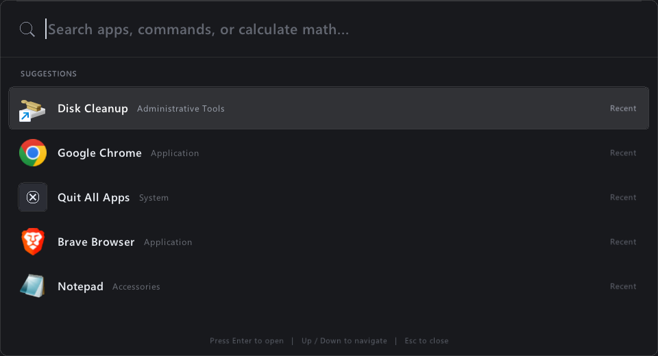

#  Flare – Desktop Search Launcher for Windows

A fast, lightweight, native-feeling desktop search launcher for Windows inspired by macOS Spotlight and Raycast.

Built with **C**, **raylib**, and the **Win32 API**.

<p align="center">
  
</p>

---

## Features

- **Floating Launcher**: Sits centered horizontally on the active monitor, placed at ~20% from the top of the working area.
- **Visual Styling**:
  - Dark slate-charcoal container (`rgba(24, 25, 29, 255)`).
  - Native Windows 11 rounded corners (`DWMWA_WINDOW_CORNER_PREFERENCE = DWMWCP_ROUND`).
  - Frosted border and top specular reflection highlight.
  - Multi-size native `Segoe UI` fonts with bilinear filtering and mipmaps for crystal-clear typography.
  - Clean high-resolution application icons extracted directly from target executables (no shortcut arrow badges).
  - Animated blinking cursor.
  - Smooth rounded selection highlight pill.
- **Native Windows 10 & 11 Integration**:
  - Borderless window (`FLAG_WINDOW_UNDECORATED`).
  - Always-on-top (`HWND_TOPMOST`).
  - Hidden from taskbar and Alt+Tab (`WS_EX_TOOLWINDOW`).
  - Subclassed Windows procedure intercepting global messages.
  - Multi-monitor support: dynamically centers on the monitor under the cursor.
  - Focus loss & click-outside detection.
- **Keyboard Shortcuts**:
  - `Alt + Space`: Global hotkey to open / toggle Flare from anywhere in Windows.
  - `Escape`: Hides Flare to the background (remains running quietly for instant reopening).
  - `Up / Down`: Navigates search results with smooth window scrolling (mouse hover does not hijack keyboard navigation).
  - `Enter`: Launches the selected application or executes system command.
  - Mouse hover & click: Pointing at any search result highlights it, and clicking selects and launches it immediately.
- **Fast Search Engine**:
  - Automatically indexes Start Menu applications and common Windows tools.
  - **Inline Math Calculator**: Evaluates arithmetic expressions in real-time (`2+2`, `15*6`, `100/4`, `(12+8)*3`, `2^10`, `sqrt(144)`, percentages, `pi`, `e`, etc.). Pressing `Enter` automatically copies the answer to your Windows clipboard!
  - Prioritized scoring: exact matches, prefix matches, acronym matches (e.g. `gc` for Google Chrome), word-boundary matches, and categories.
  - Low CPU usage with dynamic FPS throttling when hidden.

---

## Project Structure

```
flare/
├── CMakeLists.txt              # CMake build configuration
├── vendor/
│   └── raylib/                 # Raylib 5.0 git submodule
└── src/
    ├── main.c                  # Application loop & orchestration
    ├── window.h / window.c     # Win32 platform integration & window styling
    ├── renderer.h / renderer.c # Raylib vector drawing, typography & layout
    ├── animations.h / animations.c # Easing curves, fade & cursor timing
    ├── keyboard.h / keyboard.c # Text input, key event handling
    ├── search.h / search.c     # Search engine & ranked filtering
    └── applications.h / applications.c # App indexing, .lnk target resolver, execution
```

---

## Building and Running

### Prerequisites
- Windows 10 or Windows 11
- CMake 3.20+
- MinGW (GCC and `mingw32-make`)

### Build with MinGW
```powershell
# Configure with MinGW Makefiles
cmake -B build -S . -G "MinGW Makefiles" -DCMAKE_BUILD_TYPE=Release

# Compile
cmake --build build
```

### Run Flare
```powershell
.\build\Flare.exe
```
